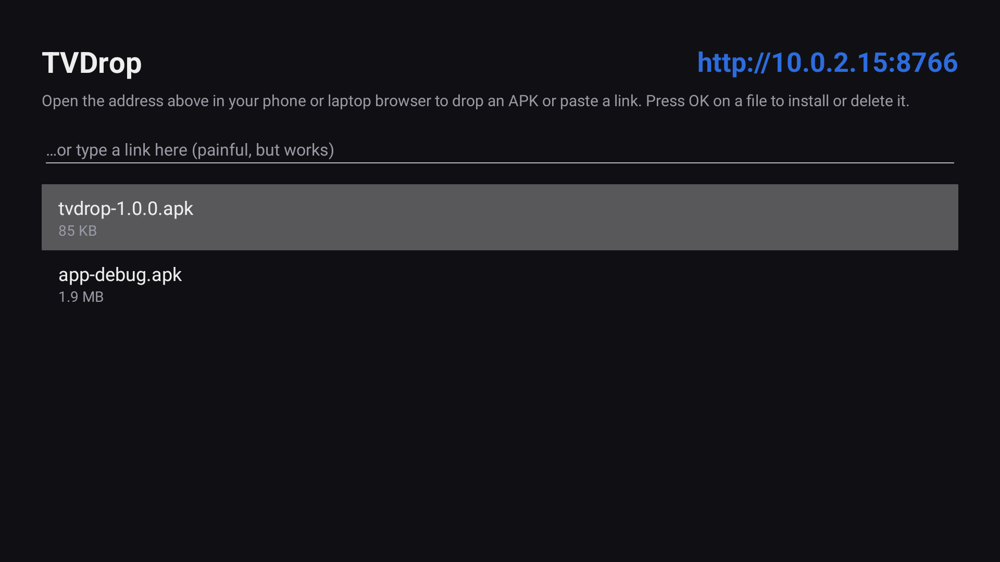
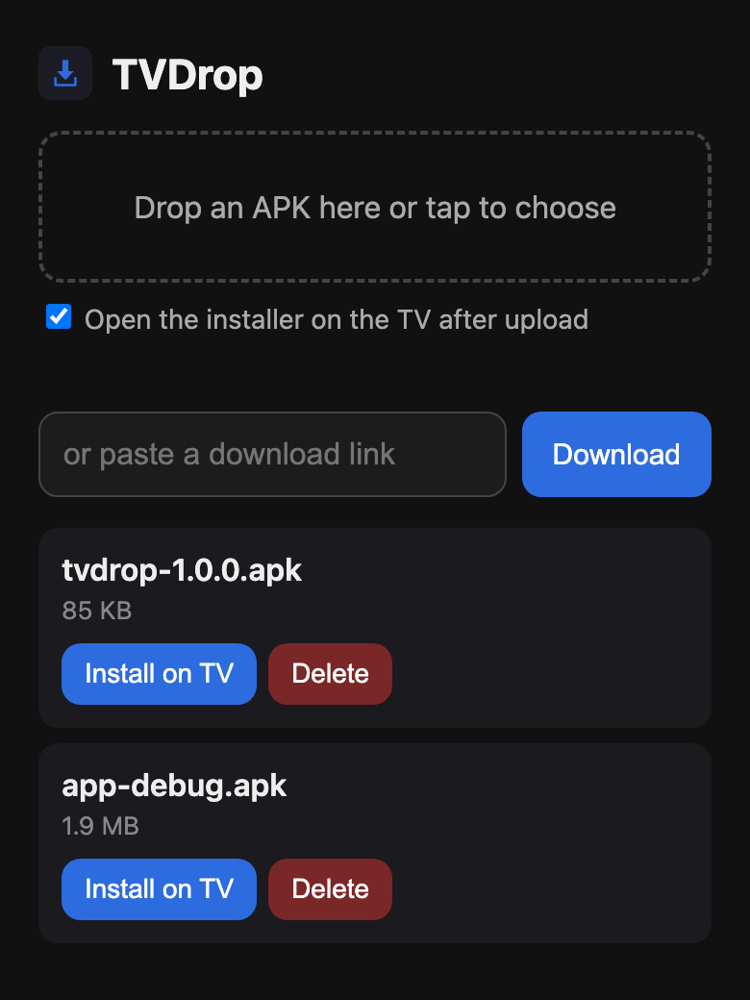
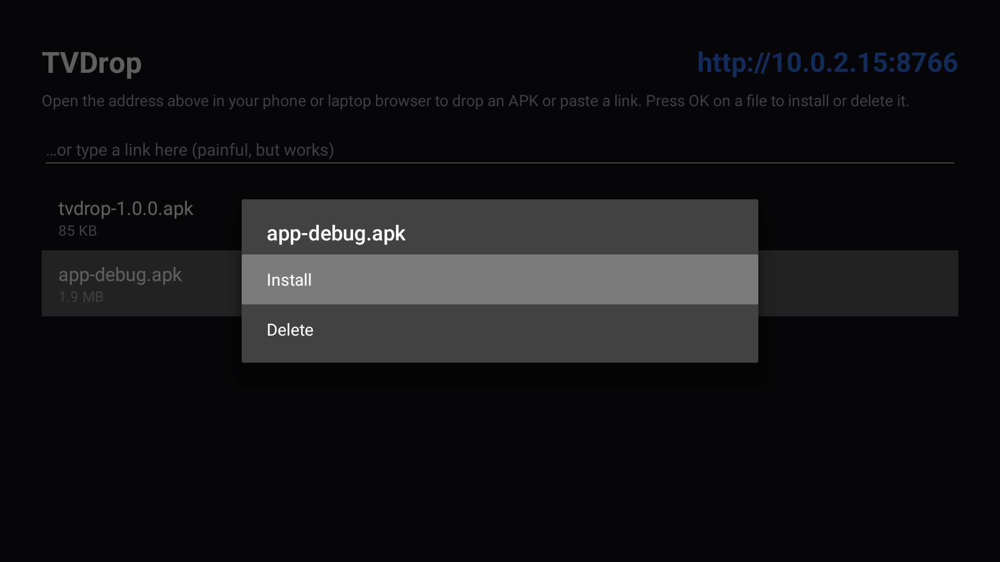

<p align="center"></p>

<h1 align="center">TVDrop</h1>

<p align="center"><b>Install apps on your Android TV from any browser.</b><br>
Open TVDrop on the TV, open its address on your phone or laptop, drop an APK. Done.</p>

<p align="center">
  <a href="https://github.com/ashutosh091/TVDrop/releases/latest/download/tvdrop.apk"><b>Download APK</b></a> ·
  <a href="https://ashutosh091.github.io/TVDrop/">Website</a> ·
  <a href="#setup">Setup guide</a> ·
  <a href="https://github.com/ashutosh091/TVDrop/releases">Releases</a>
</p>

<p align="center">&nbsp;</p>

Sideloading on a TV usually means adb, a USB stick, or typing a long URL with a remote.
TVDrop runs a tiny web server on the TV instead. Anything on the same Wi-Fi can open the page
and push files to it.

## Features

- **Drop an APK** on the page, or tap to pick one on a phone. It is pushed straight to the TV
  and the installer opens as soon as the upload finishes.
- **Paste a download link** and the TV fetches the file itself. Redirects and
  `Content-Disposition` file names are honoured, so GitHub release links work.
- **Live progress** with Install, Open, Delete and Cancel for every file.
- **Cleans up after itself.** After a successful install it asks Delete, Keep or Always delete.
- **Works from the remote too.** Press OK on a file to install, open or delete it. There is
  also a text box for typing a link when nothing else is at hand.
- **Any file**, not just APKs. Other files open in whichever app on the TV handles them.
- **Tiny and private.** About 90 KB, no accounts, no analytics, no cloud. The only dependency is
  AndroidX Core.

Works on Android 7.0+ (API 24): Android TV and Google TV devices such as Chromecast with
Google TV, Nvidia Shield, Xiaomi Mi Box and TVs from Sony, TCL, Philips and others. It also runs
on phones and tablets. Fire TV runs Android underneath and should work, but is untested.

## Setup

### 1. Get TVDrop onto the TV (once)

Pick whichever is easiest:

- **Downloader app.** Install *Downloader* by AFTVnews from the TV's app store, enter
  `ashutosh091.github.io/TVDrop`, press **Download APK** and then **Install**.
- **adb from a computer.** Turn on network debugging in the TV's Developer options, then:

  ```bash
  adb connect <tv-ip>:5555
  adb install tvdrop.apk
  ```

- **USB stick.** Copy `tvdrop.apk` to a USB drive and open it with a file manager on the TV.

After this, TVDrop updates can be dropped into TVDrop itself.

### 2. Send apps to the TV

1. Open **TVDrop** on the TV. It shows an address such as `http://192.168.1.20:8766`.
2. Open that address in a browser on your phone or laptop, on the same network.
3. Drop an APK onto the page, or paste a download link.
4. **First time only:** Android opens *Install unknown apps*. Turn it on for TVDrop and press
   Back. The install continues by itself.
5. Press **Install** on the TV. TVDrop then offers to delete the APK.

<p></p>

## Security

- The page is only reachable on your local network, and only while TVDrop is running.
- Anyone on the same network can send files, but **nothing installs without you confirming on
  the TV**.
- Requests from other websites (CSRF) and DNS-rebinding tricks are rejected. File names are
  confined to TVDrop's own folder.
- There is no password. Don't leave it running on networks you don't trust.

## Troubleshooting

- **The page won't open from the phone.** Make sure both are on the same network, not mobile
  data or a guest Wi-Fi. Some routers isolate wireless clients; turn off "AP/client isolation".
- **"App not installed".** The APK may be signed differently from a copy that is already
  installed. Uninstall the old app first.
- **Installer doesn't appear.** Open TVDrop on the TV once so Android can ask for the
  *Install unknown apps* permission.

## Building

Requires JDK 17 and the Android SDK (platform 34).

```bash
./gradlew assembleRelease      # app/build/outputs/apk/release/app-release.apk
./install.sh <tv-ip>           # build and install over adb, then launch it
```

Release signing reads `keystore.properties` from the project root (`storeFile`,
`storePassword`, `keyAlias`, `keyPassword`), or `SIGNING_*` environment variables in CI. Without
either, release builds are signed with the debug key so anyone can build.

Publishing a release: bump `versionCode`/`versionName` in `app/build.gradle.kts`, then push a
tag such as `v1.1.0`. The Release workflow builds the signed APK and attaches `tvdrop.apk` to a
GitHub release.

### Layout

| File | What it does |
| --- | --- |
| `App.kt` | Starts the server with the process, so files can arrive while the activity is in the background. |
| `Server.kt` | Plain `ServerSocket` HTTP server on port 8766 that serves the single-page UI and a small JSON API. Uploads are a raw `PUT` body, no multipart. |
| `Downloads.kt` | Transfers to `getExternalFilesDir`, written as `.part` then renamed. Manual redirect handling for link downloads. |
| `MainActivity.kt` | The TV screen. Launches `ACTION_INSTALL_PACKAGE`, handles the unknown-sources detour, uses `PACKAGE_ADDED` as a fallback, then the delete prompt. |

## License

[MIT](LICENSE)
